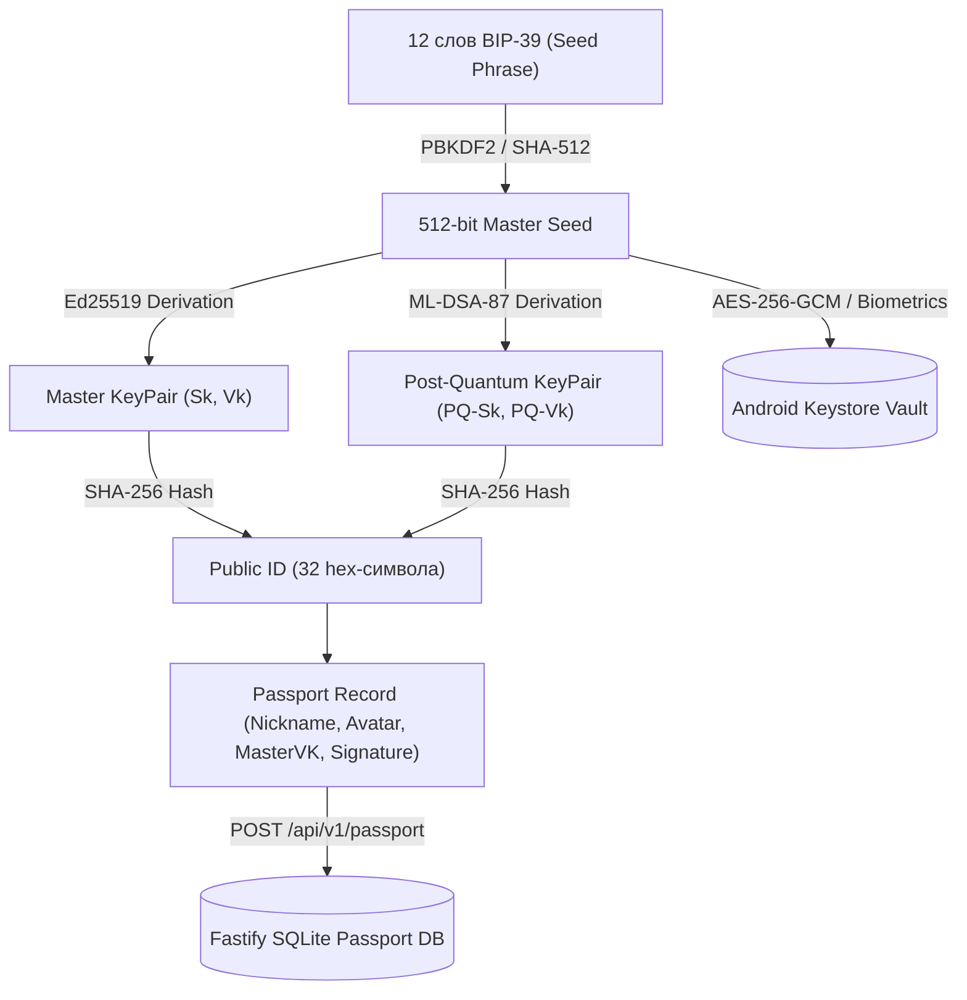

# AnonGram: Полная энциклопедия проекта, история создания и Архитектурная спецификация Регистрации / Входа (Jetpack Compose + Core)

> **Agent Handoff & Architecture Master Specification**  
> Проект: **AnonGram (АнонГрам)** — Zero-Knowledge Blind-Relay мессенджер с пост-квантовой защитой  
> Дата: 10 ноября 2026 г.  
> Версия: 2.0 (Complete System Reference & Auth Roadmap)

---

## 1. Миссия и философия AnonGram

**AnonGram** создаётся как бескомпромиссная альтернатива современным централизованным и псевдо-защищённым мессенджерам. 

### Главные инварианты протокола и проекта
1. **Слепой релей (Zero-Knowledge Blind Relay)**:
   - Сервер **никогда не знает** реальных номеров телефонов, email, паролей, открытых текстов сообщений или связей между пользователями.
   - Сервер выступает исключительно в роли «слепого почтового отделения», маршрутизируя сквозным образом зашифрованные конверты (`EncryptedEnvelope`) по обезличенному `public_id` адресата.
2. **Абсолютная анонимность пересылки (AnonGram Core Rule)**:
   - Пересылка сообщений ВСЕГДА на 100% анонимна: `forwardedFrom = null`.
   - В интерфейсе баблов и базы данных строго запрещены любые плашки и метаданные вида «Переслано от ...».
3. **Пост-квантовая гибридная криптография**:
   - Идентификатор пользователя `public_id` формируется как Hex SHA-256 от гибридного мастер-ключа верификации (`Ed25519` + `ML-DSA-87`).
   - Обмен сессионными ключами строится на гибриде `X25519` + `ML-KEM`.
4. **СТРОЖАЙШИЕ ПРАВИЛА СБОРКИ И ДЕПЛОЯ (ОБЯЗАТЕЛЬНО ДЛЯ ВСЕХ АГЕНТОВ)**:
   - **СТРОГО ЗАПРЕЩЕНО запускать локальную сборку (`./gradlew`) на компьютере пользователя**.
   - Все сборки Android APK выполняются **исключительно через облачный CI (GitHub Actions)**:
     1. `git add -A && git commit -m "..." && git push origin main`
     2. Мониторинг Cloud CI через GitHub API (скрипт `scratch/download_apk.py` / `monitor_and_download.py`)
     3. Скачивание артефакта APK `app-debug.apk` в папку `build-artifacts/debug/`
   - **НИКОГДА не запускать приложение автоматически после установки**:
     - Выполнять ТОЛЬКО тихую установку обновления: `adb -t 1 install -r -d build-artifacts/debug/app-debug.apk`
     - **ЗАПРЕЩЕНО** вызывать команды `am start`, `monkey` и любые другие лаунчеры. Пользователь откроет приложение сам на своём телефоне, когда ему будет удобно!

---

## 2. Полная хронологическая история разработки проекта

AnonGram прошёл огромный путь последовательной эволюции:

### Этап 1. Ядро сервера слепого релея (Backend Fastify)
- Разработан ультра-быстрый бэкенд на **Fastify + WebSockets + SQLite**:
  - `backend/src/index.ts`: Точка входа, WebSocket сервер `/ws`, эндпоинты `/health` и `/api/v1/passport`.
  - `SqlitePassportStorage`: Персистентное хранилище подписанных паспортов пользователей с защитой от отката версий (`downgrade attack`).
  - `BlindRelayRouter`: Маршрутизатор зашифрованных конвертов `EncryptedEnvelope` и сигналов звонков `CallSignalMessage` в реальном времени.

### Этап 2. Архитектура Android-клиента (Jetpack Compose & Obsidian Theme)
- Клиент построен на современных принципах Android Clean Architecture:
  - **Edge-to-Edge**: Полноэкранный рендеринг под статус-баром и навигационной полосой.
  - **WindowSizeClass**: Адаптивность интерфейса под смартфоны, складные устройства и планшеты.
  - **Obsidian Theme**: Тёмная неоновая эстетика (`ObsidianBlack = #0D0B14`, глубокие фиолетовые акценты `#8B5CF6`, `#C084FC`).
  - **Navigation**: `MainAppShell` с 4 табами (Чаты, Звонки, Контакты, Профиль) и плавающим островком с центральной кнопкой быстрого QR-сканера.

### Этап 3. Эволюция поля ввода и чата
1. **Монолитный плавающий островок ввода (`ChatInputBar.kt`)**:
   - Включает кнопку стикеров/эмодзи, динамическое поле ввода (растущее до 160dp), скрепку вложений и динамическую кнопку отправки/голосового сообщения.
   - Кнопка разворачивания в полный экран `⤢` при вводе длинного текста.
2. **Полноэкранный редактор текста (`ChatFullTextEditorScreen.kt`)**:
   - Undo/Redo стек правок.
   - Плавающий центрированный тулбар над клавиатурой (`TextFormattingToolbar`).
   - Панель стилей `Aa` с подменю заголовков `H1`–`H6` (`HeadingPickerSubmenu`).
   - Меню списков: маркеры `•`, цифры `1.`, римские `I.`, стрелочки `->`, чек-боксы `[ ]`.
   - Панель ввода формул LaTeX (`LatexFormulaInputPanel`) с чистым полем ввода и кнопкой «Готово».
3. **Плавающая панель выделения текста (`TextSelectionFloatingBar.kt`)**:
   - Всплывает точно над выделенным текстом: кнопки `B`, `I`, `U`, `S̶`, `✦` (спойлер), `Aa`.
   - Кнопка `</>` убрана по требованию пользователя для чистоты интерфейса.
   - Форматирование применяется нативно через `SpanStyle` без вставки сырых звёздочек `**` (чистый WYSIWYG).
4. **Рендеринг сообщений в баблах (`features/chats/ui/components/bubble/`)**:
   - `MessageBubble.kt`: 100% непрозрачные баблы (`Color(0xFF281C3D)` и `CardDark`), устранившие просвечивание обоев чата.
   - `BubbleTextMessage.kt`: Инлайн-спойлеры со слоем мерцающих фиолетовых искр (Canvas), раскрывающиеся по клику без разбиения текста на колонки.
   - `BubbleCollapsibleBlock.kt`: Сворачиваемые блоки с шевроном `^`/`v` по макету дизайна.
   - `BubbleLatexFormula.kt`: Математические карточки с бейджем `∑ LaTeX`.
   - Чек-листы: Крупные фиолетовые чекбоксы (22x22dp со скруглением и белой галочкой `✓`).
5. **Архитектурная защита скрепки ("атаку щит")**:
   - Основной модуль `features/attach/` (`AttachSheet.kt`, `AttachSheetContent.kt`) признан неприкосновенным ядром и **строго защищён от правок**.
   - Для инпута и редактора создаётся выделенный [EditorAttachSheet.kt](file:///home/jackson/anongram/frontend/android/app/src/main/java/com/anongram/app/features/chats/ui/input/editor/EditorAttachSheet.kt), который переиспользует визуальный ряд вложений, но добавляет кнопку подтверждения `✓` («Готово») и складывает медиа в черновик сообщения `attachedMediaList`, не отправляя их сразу в чат.

---

## 3. Архитектура Регистрации и Входа (Аутентификация AnonGram)

### 3.1. Криптографическая концепция: No-Identity & Self-Sovereign Identity
В AnonGram **нет понятия учетной записи на сервере**:
- Нет связки с телефонным номером.
- Нет подтверждения по SMS или Email.
- Пользователь **сам является своим центром сертификации**.
- Единственный источник правды — криптографическая мнемоника **BIP-39 (12 слов)**.



### 3.2. Спецификация данных и контрактов

#### 1. Модели данных (`com.anongram.app.features.auth.domain.model`)
```kotlin
package com.anongram.app.features.auth.domain.model

/**
 * Идентификатор и локальный профиль пользователя
 */
data class UserIdentity(
    val publicId: String,          // 32-значный hex (SHA-256 от MasterVK)
    val nickname: String,          // Пользовательский псевдоним (напр. "GhostWalker")
    val avatarUri: String?,        // Локальный путь к аватару или null
    val masterVkHex: String,       // Публичный ключ Ed25519
    val pqMasterVkHex: String? = null, // Публичный ключ ML-DSA
    val isBiometricsEnabled: Boolean = false,
    val isPinSet: Boolean = false
)

/**
 * Глобальное состояние аутентификации приложения
 */
sealed interface AuthState {
    data object Loading : AuthState
    data object Unauthenticated : AuthState
    data class Authenticated(val identity: UserIdentity) : AuthState
}

/**
 * Мнемоническая фраза BIP-39
 */
data class SeedPhrase(
    val words: List<String>
) {
    init {
        require(words.size == 12 || words.size == 24) { "Mnemonic must be 12 or 24 words" }
    }
    
    val text: String get() = words.joinToString(" ")
}
```

#### 2. Интерфейс репозитория (`IAuthRepository.kt`)
```kotlin
package com.anongram.app.features.auth.domain.repository

import com.anongram.app.features.auth.domain.model.AuthState
import com.anongram.app.features.auth.domain.model.SeedPhrase
import com.anongram.app.features.auth.domain.model.UserIdentity
import kotlinx.coroutines.flow.StateFlow

interface IAuthRepository {
    val authState: StateFlow<AuthState>

    suspend fun checkExistingSession(): AuthState
    suspend fun createIdentity(nickname: String): Pair<UserIdentity, SeedPhrase>
    suspend fun restoreIdentity(seedPhrase: SeedPhrase): Result<UserIdentity>
    suspend fun saveIdentityToKeystore(identity: UserIdentity, seedPhrase: SeedPhrase, pin: String? = null)
    suspend fun publishPassportToServer(identity: UserIdentity): Result<Unit>
    suspend fun logout(): Result<Unit>
}
```

---

## 4. Пользовательские сценарии и UI в Jetpack Compose

Модуль расположен в `com.anongram.app.features.auth.ui`:

### Сценарий 1. Первый запуск (Приветствие) — `WelcomeScreen.kt`
- **Дизайн**: Футуристический тёмный фон `ObsidianBlack`, анимированный щит AnonGram с фиолетовым неоновым ореолом.
- **Инфографика**:
  - 🛡️ *100% анонимность: без SIM-карт и почты*
  - ⚡ *Слепой сервер: данные видите только вы*
  - 🔐 *Полный контроль над своими ключами*
- **Кнопки**:
  - `«Создать анонимную личность»` (яркая фиолетовая капсула `#8B5CF6`).
  - `«Войти по Seed-фразе или QR»` (контурная кнопка с полупрозрачным фоном).

### Сценарий 2. Создание профиля — `CreateIdentityScreen.kt`
- Ввод псевдонима с ограничением и подсказкой: «Псевдоним видят только ваши собеседники».
- Генератор анонимных аватаров (случайные неоновые геометрические градиенты или выбор фото).
- Анимированный статус генерации ключей:
  - `Генерация мастер-ключа Ed25519...`
  - `Генерация квантового бандла ML-DSA-87...`
  - `Формирование Public ID...`
- Кнопка **«Продолжить к сохранению ключей»**.

### Сценарий 3. Резервное копирование мнемоники — `BackupSeedScreen.kt`
- **Критический экран безопасности**:
  - Плашка предупреждения (красновато-фиолетовый акцент): *«Никогда не передавайте эту фразу третьим лицам. Если вы её потеряете, восстановить переписку будет невозможно!»*.
  - Красивая сетка 3x4 из 12 слов. Каждое слово в карточке: номер (серый `1.`, `2.`) + слово (белый жирный шрифт).
  - Кнопка **«Скопировать в буфер обмена»** (с автоматической очисткой или тостом).
  - Кнопка **«Я сохранил слова»**: запускает интерактивный мини-тест (Memory Quiz), в котором пользователя просят выбрать, например, 3-е, 7-е и 11-е слово из предложенных вариантов.
  - После успешного теста — аккаунт регистрируется, паспорт отправляется на сервер, и открывается `MainAppShell`.

### Сценарий 4. Восстановление аккаунта — `RestoreAccountScreen.kt`
- Удобное поле ввода 12 слов с автокомплитом по официальному словарю BIP-39.
- Кнопка **«Вставить из буфера»** (парсит строку на 12 слов и заполняет чипы).
- Кнопка **«Сканировать резервный QR-код»**.
- Проверка чек-суммы: если слова введены с ошибкой — подсветка красным.
- При успехе — деривация ключей, запрос паспорта с сервера `/api/v1/passport/:publicId` и переход в чаты.

### Сценарий 5. Защита входа — `PinLockScreen.kt`
- 4-значный или 6-значный цифровой код.
- Кнопка быстрой биометрической аутентификации (отпечаток пальца / лицо).

---

## 5. Связка с ядром бэкенда и WebSocket

После того как пользователь авторизован:
1. `UserIdentity.publicId` используется для всех сетевых запросов.
2. Приложение устанавливает WebSocket-соединение с бэкендом (`backend/src/index.ts`):
```json
{
  "type": "auth",
  "publicId": "8f3ab71c90...921"
}
```
3. Сервер регистрирует сокет в `BlindRelayRouter` и отвечает:
```json
{
  "type": "auth_ack",
  "publicId": "8f3ab71c90...921"
}
```
4. Начиная с этого момента клиент готов отправлять и принимать зашифрованные конверты `EncryptedEnvelope` и звонки в реальном времени.

---

## 6. ГОТОВЫЙ МАСТЕР-ПРОМПТ ДЛЯ ЗАПУСКА АГЕНТА / СУБАГЕНТА

Скопируйте текст ниже и передайте его агенту (или используйте для автономного запуска субагента):

```text
Ты — ведущий Android-разработчик AnonGram (Kotlin, Jetpack Compose, Clean Architecture).

ТВОЯ ЗАДАЧА:
Разработать и подключить модуль Регистрации и Аутентификации в пакете `com.anongram.app.features.auth` в соответствии со спецификацией REGISTRATION_AND_AUTH_SPEC.md и связать его с MainActivity.kt.

ЖЕСТКИЕ ПРАВИЛА ПРОЕКТА:
1. СТРОГО ЗАПРЕЩЕНО запускать локальную сборку `./gradlew` на машине пользователя. Сборка выполняется ТОЛЬКО через GitHub Actions Cloud CI (git commit && git push origin main).
2. При установке APK на устройство (adb -t 1 install -r -d ...) выполнять ТОЛЬКО тихую установку. ЗАПРЕЩЕНО запускать приложение через monkey, am start и т.д. Пользователь откроет его сам!
3. Все пересылки сообщений строго анонимны (forwardedFrom = null).
4. Основной модуль features/attach/ ЗАЩИЩЁН и НЕ ДОЛЖЕН модифицироваться.
5. Регистрация полностью децентрализована: 12 слов BIP-39, деривация Ed25519, publicId = SHA256(MasterVK). Никаких номеров телефонов или email!

ПЛАН РЕАЛИЗАЦИИ:
Шаг 1. Создать доменные модели и интерфейс репозитория:
- `com.anongram.app.features.auth.domain.model.UserIdentity`
- `com.anongram.app.features.auth.domain.model.AuthState`
- `com.anongram.app.features.auth.domain.model.SeedPhrase`
- `com.anongram.app.features.auth.domain.repository.IAuthRepository`

Шаг 2. Реализовать криптографию и локальное защищённое хранилище (data layer):
- `Bip39WordList.kt`: встроенный массив 2048 слов BIP-39.
- `KeyGenerator.kt`: генератор 12 слов, деривация seed и вычисление publicId (SHA-256).
- `KeystoreVault.kt`: сохранение профиля и ключей в EncryptedSharedPreferences / SharedPreferences с шифрованием.
- `AuthRepositoryImpl.kt`: реализация IAuthRepository с публикацией паспорта на бэкенд.

Шаг 3. Реализовать UI-экраны в Jetpack Compose (ObsidianBlack, неоновый фиолетовый #8B5CF6):
- `WelcomeScreen.kt`: приветствие с логотипом, описанием преимуществ и кнопками «Создать личность» и «Войти».
- `CreateIdentityScreen.kt`: ввод псевдонима, выбор аватара, визуализатор генерации ключей.
- `BackupSeedScreen.kt`: сетка 3x4 из 12 слов, предупреждение о безопасности, копирование и тест памяти (выбор 3-го и 7-го слова).
- `RestoreAccountScreen.kt`: ввод 12 слов с автокомплитом и вставкой из буфера.
- `AuthViewModel.kt`: управление StateFlow<AuthState>.
- `AuthNavGraph.kt`: навигация между экранами авторизации.

Шаг 4. Интеграция в MainActivity:
- При запуске проверять authRepository.checkExistingSession(). Если пользователь не авторизован — открывать AuthNavGraph.
- При успешной авторизации плавно переключать на MainAppShell.

Шаг 5. Деплой и верификация:
- git commit и git push origin main.
- Дождаться сборки в GitHub Actions Cloud CI.
- Скачать APK и установить через adb -t 1 install -r -d build-artifacts/debug/app-debug.apk.
- Ни в коем случае НЕ открывать приложение через adb!
```
